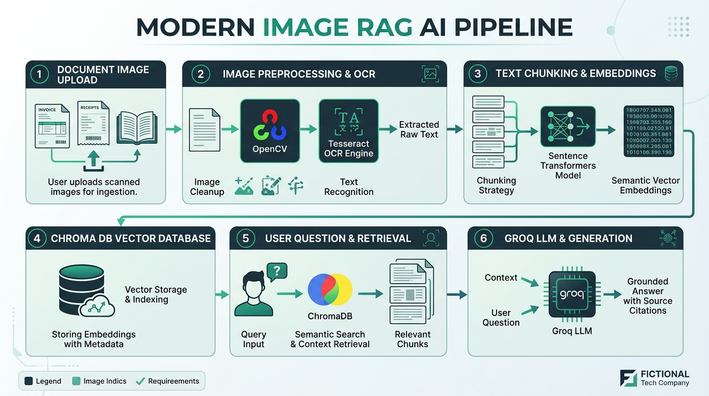
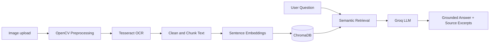

# Framewise (ChatForge AI)

**Ask what your images know.** Framewise turns text inside an image into a searchable, question-answering workspace. Upload a scan, screenshot, or photographed page; inspect the extracted text; then ask questions and get answers grounded in the source.

---

## Project Abstract

Framewise is an image-based retrieval-augmented generation (RAG) system for asking natural-language questions about text found in images. OpenCV prepares each image for recognition, and Tesseract OCR extracts its text. The text is cleaned and split into overlapping chunks, which are converted into semantic embeddings and stored in ChromaDB. When a user asks a question, the system retrieves the most relevant chunks and supplies them to a Groq-hosted large language model. The model responds using the retrieved content, while the interface displays the source excerpts so answers remain transparent and traceable.

## Architecture





---

## How to Host Online (Free Cloud Platforms)

This repository is pre-configured with everything needed to host online (`packages.txt` for Debian/Ubuntu, `Dockerfile`, and cross-platform Tesseract auto-detection).

Choose either **Streamlit Cloud** or **Hugging Face Spaces** depending on which interface you want to publish:

### Option 1: Streamlit Community Cloud (Recommended for Streamlit UI)
* **Cost**: 100% Free
* **Interface**: `streamlit_app.py`
* **Prerequisites**: A free account on [streamlit.io/cloud](https://streamlit.io/cloud) and your repository on GitHub.

1. **Push this folder to GitHub**:
   ```bash
   git init
   git add .
   git commit -m "Initial commit for cloud deployment"
   git branch -M main
   git remote add origin https://github.com/<YOUR_USERNAME>/<YOUR_REPO_NAME>.git
   git push -u origin main
   ```
2. **Deploy on Streamlit Community Cloud**:
   - Go to [share.streamlit.io](https://share.streamlit.io/) and log in with GitHub.
   - Click **Create app** > **I already have an app**.
   - Select your repository and branch (`main`).
   - Set **Main file path** to `streamlit_app.py`.
   - Click **Advanced settings** > **Secrets** and add:
     ```toml
     GROQ_API_KEY = "your_actual_groq_api_key"
     GROQ_MODEL = "openai/gpt-oss-120b"
     ```
   - Click **Deploy**. Streamlit Cloud will automatically read `packages.txt` to install Tesseract OCR and launch your app.

---

### Option 2: Hugging Face Spaces (Recommended for FastAPI + Web Interface)
* **Cost**: 100% Free (Provides **16 GB RAM**, ideal for PyTorch embeddings)
* **Interface**: Custom modern dashboard via `main.py` + `static/`

1. Go to [huggingface.co/spaces](https://huggingface.co/spaces) and click **Create new Space**.
2. Set Space SDK to **Docker** (Blank).
3. Push this repository's code to the Space repository (or connect your GitHub repo).
4. Go to **Settings** > **Variables and secrets** and create:
   - Secret `GROQ_API_KEY`: `<your_groq_api_key>`
   - Variable `GROQ_MODEL`: `openai/gpt-oss-120b`
5. Hugging Face will automatically build the `Dockerfile` and provide a public URL.

---

### Option 3: Render.com (FastAPI Web Service)
1. Push this repository to GitHub.
2. Go to [render.com](https://render.com) and create a **New Web Service**.
3. Connect your repository.
4. Select environment **Docker**.
5. Add the environment variable `GROQ_API_KEY` under the Environment tab.
6. Click **Create Web Service**.

---

## Running with Docker Locally

To run the complete containerized stack locally using Docker:

```bash
# Build the Docker image
docker build -t framewise-ai .

# Run the container (passing your Groq API key)
docker run -p 7860:7860 -e GROQ_API_KEY="your_groq_api_key_here" framewise-ai
```

Then open `http://localhost:7860` in your browser.

---

## Local Setup (Without Docker)

1. Install Python 3.10+ and [Tesseract OCR](https://github.com/UB-Mannheim/tesseract/wiki). On Windows, install to `C:\Program Files\Tesseract-OCR\` or add to system `PATH`.
2. Create and activate a virtual environment:
   ```powershell
   py -m venv .venv
   .\.venv\Scripts\Activate.ps1
   pip install -r requirements.txt
   ```
3. Copy `.env.example` to `.env` and set your `GROQ_API_KEY`:
   ```powershell
   Copy-Item .env.example .env
   ```
4. Run either interface:
   - **Streamlit App**:
     ```powershell
     streamlit run streamlit_app.py
     ```
   - **FastAPI + Custom Web UI**:
     ```powershell
     uvicorn main:app --reload
     ```

---

## Tech Stack

* **Backend / API**: FastAPI, Uvicorn
* **UI**: Streamlit & Native HTML5 / CSS3 / JavaScript
* **Vision & OCR**: OpenCV, Tesseract OCR (`pytesseract`)
* **Embeddings & Vector Store**: LangChain, Sentence-Transformers (`all-MiniLM-L6-v2`), ChromaDB
* **LLM Engine**: Groq Cloud API
